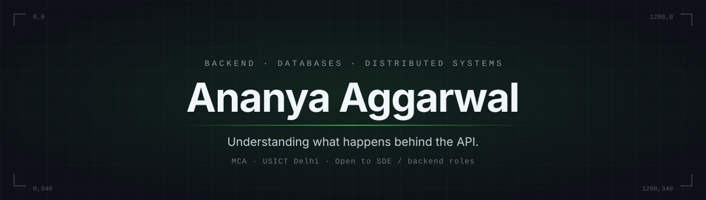

  

  
  &nbsp;
  

  <code>MCA Software Engineering · USICT, Delhi · Delhi, India</code> 
  <code>Mathematics background. I care about what happens below the API.</code> 
  <code>Node.js · TypeScript · Python · PostgreSQL · Docker</code>

  <b>Open to: SDE / backend roles</b>

---

## What I've Built

<table>
  <tr>
    <td valign="top" width="50%">
      <a href="https://github.com/Ananya200305/pizzeria"><b>Microservices Application</b></a>  
      A backend split into independent services with their own boundaries, REST APIs, inter-service communication, and explicit error handling. Runs end to end with Docker. 
     Handling Downtime issues in different services. 
      <code>Node.js</code> <code>TypeScript</code> <code>PostgreSQL</code> <code>Docker</code>
    </td>
    <td valign="top" width="50%">
      <a href="https://github.com/Ananya200305/LensOS"><b>LensOS</b></a>  
      Search your images in plain English. Queries and images are embedded with CLIP and matched through vector similarity search. 
     Handle Background jobs asynchronously. Reducing upload time by 20%. 
      <code>Python</code> <code>FastAPI</code> <code>CLIP</code> <code>Qdrant</code> <code>PostgreSQL</code>
    </td>
  </tr>
  <tr>
    <td valign="top" width="50%">
      <a href="https://github.com/Ananya200305/CrowdGuard"><b>Crowd Guard</b></a>  
      Real-time crowd-density monitoring. Events stream through Kafka to flag potential safety concerns as they develop.  
      <code>Python</code> <code>Django</code> <code>Kafka</code> <code>React</code>
    </td>
    <td valign="top" width="50%">
      <a href="https://github.com/Ananya200305/concert-compass"><b>Concert Compass</b></a>  
      Chrome extension that finds concerts near you based on your music taste, using the Spotify and Ticketmaster APIs.  
      <code>JavaScript</code> <code>Spotify API</code> <code>Ticketmaster API</code>
    </td>
  </tr>
</table>

<!--
TODO (this is what separates a good profile from a great one): end each card's description with
ONE concrete result, for example "handles N req/s", "p95 under X ms", "indexes N images",
"keeps serving when one service is killed". Real numbers beat adjectives.
-->

Also: <a href="https://github.com/Ananya200305/react-weather-app">Weather Dashboard</a> · <a href="https://github.com/Ananya200305/Movie-prediction">Movie Sequel Prediction</a>

---

## Currently

- Extending the microservices project with failure handling and observability
- Working through *Designing Data-Intensive Applications* to ground the practical work in theory

<!-- TODO: link the exact repo or branch you're working on so this section is verifiable. -->

---

## Stack

<table>
  <tr>
    <td><b>Languages</b></td>
    <td><code>TypeScript</code> <code>Python</code> <code>Java</code> <code>JavaScript</code> <code>C++</code></td>
  </tr>
  <tr>
    <td><b>Backend</b></td>
    <td><code>Node.js</code> <code>Express</code> <code>FastAPI</code> <code>Django</code> <code>REST</code></td>
  </tr>
  <tr>
    <td><b>Data and messaging</b></td>
    <td><code>PostgreSQL</code> <code>MongoDB</code> <code>MySQL</code> <code>Redis</code> <code>Kafka</code> <code>Qdrant</code></td>
  </tr>
  <tr>
    <td><b>Tooling</b></td>
    <td><code>Docker</code> <code>Git</code> <code>Linux</code> <code>Postman</code></td>
  </tr>
</table>

---

  Outside code: documentary and street photographer, three published coffee table books. 
  Best reached by <a href="mailto:aggarwalananya03@gmail.com">email</a> or <a href="https://www.linkedin.com/in/ananya-aggarwal-64872827a/">LinkedIn</a>.

